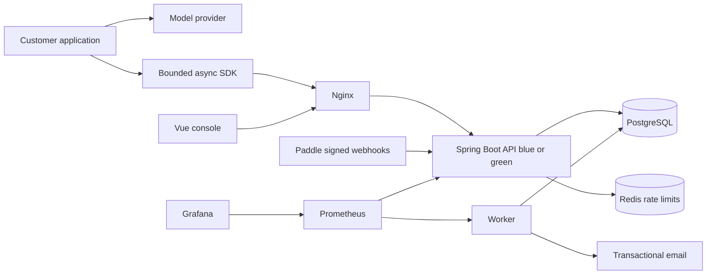

# Architecture and invariants

## Persistence and transaction boundaries

The API and worker share an image. Compose sets `WORKER_ENABLED=false` for API slots and true for the worker. PostgreSQL is the source of truth; Redis failure blocks rate-limited ingress rather than losing data or acting as a durable queue.

1. Authenticate project key and bound the compressed/uncompressed payload.
2. Validate the envelope, then acquire the workspace quota row lock.
3. Validate each event; compare transport and object identity; reserve new units in array order.
4. Commit batch, immutable transport payload, object revision placeholder, and usage ledger.
5. Return 200. The Worker locks a pending batch using `SKIP LOCKED`, upserts only higher object revisions, and marks events/batch complete in the same transaction.

The transaction lock is the worker lease. A crash/connection loss rolls back work and releases it immediately. There is no externally expiring lease that could let a second worker process an uncommitted batch simultaneously. Work transactions are limited to at most 500 small events. No frontend acknowledgement precedes durable persistence.

After 10 failures with 30-second retry delays, a batch is quarantined for audited owner replay. Email-verified permanent failure releases eligible current-period reservations exactly once. The reservation generation distinguishes a later corrected acceptance from the original charge; transport retries cannot trigger another refund or charge. Objects already materialized or having other pending updates are not released. Closed-period corrections fail closed for separate financial review.

Ingress applies a 240,000 request/minute/project guardrail and refuses new batch requests with 503 when the observed pending/quarantined event backlog exceeds 50,000. Concurrent in-flight admissions can overshoot this operational threshold; this is backpressure, not a throughput/SLA guarantee. Tune it after capacity tests.

The analytical table is a single `objects` relation keyed by project/type/object ID, representing the document's logical traces/observations/scores. Current costs and usage are queried from this canonical table. This avoids asynchronous aggregate double-counting at this stage, but queries must be benchmarked and summarized/partitioned before claiming the requested 1,000 EPS + 20 QPS capacity.

## Ownership

The current release has one owner per workspace, consistent with the exclusion of team invitations. All console project queries include the owning workspace in SQL and run a service-level access check. API keys can only write their own project and query their own batch results. A Score can never resolve a target from another project.

## Sessions and sensitive operations

Opaque session tokens have 256 bits of entropy, are stored as hashes, and are revocable. Normal sessions expire after 12 hours; selecting “Keep me signed in for 30 days” uses a fixed 30-day lifetime for both the database session and persistent cookie. Password and GitHub sign-in honor this choice. Logout revokes the current token; password resets and email changes revoke all sessions, including remembered sessions. SameSite=Lax/HttpOnly cookies hold the token; Secure is enabled by default. State-changing console calls require the session-bound `X-CSRF-Token`. The frontend only holds the CSRF value and public account metadata; it never stores the session token or password in localStorage. An authenticated visit to the login page resumes the workspace automatically.

Codes use a CSPRNG, HMAC with `APP_SECRET`, 5-minute expiry and 5-failure lockout. Challenge validation uses a separate atomic transaction so failed attempts cannot be rolled back by a rejected operation. Consumption occurs before the sensitive mutation; if a later mutation fails, the code remains consumed and the user must request another. Challenges bind the exact key name, project/key ID, target email or overage settings, as applicable.

Outbox bodies are AES-GCM encrypted with an application-secret-derived key. Successful delivery clears the encrypted body; no code/token/key/password is included in audit records. Audit metadata is append-only through public APIs; database administrators still have the database's administrative powers.

## Retention

Free retains 30 days, Core 90 days, Pro 1,096 days of queryable detail in PostgreSQL. No cold object-store archive is provisioned; the retained detail is not substituted with summaries. Cost/capacity of the full Pro retention must be verified before sale. Query-level retention applies immediately even before hourly cleanup.

Transport data is removed only after processing and 8 days. Object billing identities and unit ledger are independent and persist after detail expiry. Deletion revokes keys immediately, marks projects deleted, suppresses further analytical access, and removes detail asynchronously. Financial/audit retention periods must be confirmed before adding destructive cleanup for these records. Pending batches are never silently discarded on a generic database failure.

## Billing boundaries

Subscription states only come from verified provider notifications or authenticated server-to-server reconciliation. Paid quota does not automatically roll into a new period without provider confirmation. Webhook events are unique by provider event ID. Subscription updates compare `occurred_at`; transaction/refund records compare their own timestamps. Checkout uses a backend-created intent to bind provider metadata to a workspace.

There is no live card form and no automatic frontend entitlement grant. The default Paddle endpoint is sandbox. Plan-change proration, cancellation access, refunds, add-on pricing and live overage collection use the gated flow documented in usage-collection.zh-CN.md; activation and real payment acceptance remain separate checks.
